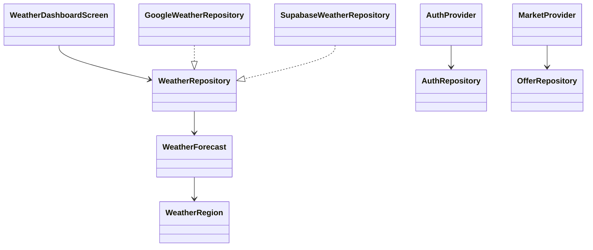

# 🌾 AgroTrade Direct

> **Plataforma móvil para la negociación y trazabilidad de exportaciones de café y cacao entre Colombia y la Unión Europea.**

AgroTrade Direct es una aplicación móvil desarrollada en **Flutter** diseñada para **RiTech SAS**. Conecta directamente a pequeños y medianos exportadores colombianos con importadores de la Unión Europea mediante un modelo dinámico de negociación de precios estilo *InDrive*.

---

## 🔗 Enlaces Importantes

- 📄 **Espacio en Confluence:** https://tinaynn.atlassian.net/wiki/x/CAAC
- 📊 **Diapositivas:** https://tinaynn.atlassian.net/wiki/x/CAAC
- 🎨 **Mockups:** https://shed-distort-65346516.figma.site/
- 📊 **Product Backlog & Requerimientos:** [Google Drive - AgroTrade Backlog](https://drive.google.com/file/d/1MKV_Ac984Y7VsclXakVrPD6ntK1H9-Cx/view?usp=drive_link)

---

## 📌 Información General

- **Impulsora / UX Lead:** Valentina Burbano
- **Aprobador:** Profesora / Cliente (Representante de RiTech SAS)
- **Estado del Proyecto:** ✅ Finalizado (prototipo funcional, clima y persistencia preparados)
- **Fecha de Finalización:** 07 de noviembre de 2026

---

## 🚨 Planteamiento del Problema

### Problema
Los pequeños y medianos exportadores colombianos de café y cacao enfrentan intermediaciones complejas, opacidad en la fijación de precios y barreras de entrada para conectar directamente con los compradores en la Unión Europea. Esta falta de canal directo limita el margen de ganancia de los productores agrícolas y dificulta la trazabilidad requerida por los importadores europeos.

---

## 👥 Equipo de Trabajo

| Nombre | Rol Principal | Responsabilidades |
| :--- | :--- | :--- |
| **David Luna** | Product Owner / Developer | Gestión del Backlog, definición de producto y desarrollo |
| **Valery Rosero** | Scrum Master / Developer | Facilitación ágil, arquitectura general y desarrollo |
| **Omar Acosta** | Developer Lead (Flutter) | Liderazgo de arquitectura Frontend y UI/UX implementation |
| **Johan Delgado** | Backend & Database Engineer | Integración de Supabase, API REST y base de datos PostgreSQL |
| **Valentina Burbano** | UX/UI Designer & QA Specialist | Diseño de interfaz/prototipos, experiencia de usuario y estrategia QA |

---

## 📅 Cronograma e Hitos

| Hito | Responsable | Fecha Límite | Estado |
| :--- | :--- | :--- | :--- |
| **Hito 1:** Propuesta comercial/técnica y User Story Map (25 REQ) | David Luna | 2026-09-05 | ✅ Completado |
| **Hito 2:** Aprobación de Confluence y arquitectura de datos | Valery Rosero | 2026-09-12 | ✅ Completado |
| **Hito 3:** Diseño de prototipos de alta fidelidad | Valentina Burbano | 2026-09-20 | ✅ Completado |
| **Hito 4:** Backend y servicios de autenticación | Johan Delgado | 2026-10-05 | ✅ Completado |
| **Hito 5:** Desarrollo frontend, clima y conexión | Omar Acosta | 2026-10-18 | ✅ Completado |
| **Hito 6:** Pruebas QA y APK final | Valentina Burbano / Equipo | 2026-11-07 | ✅ Completado |

---

## 🛠️ Stack Tecnológico y Arquitectura

- **Lenguaje:** Dart 3.3+
- **Framework Frontend:** Flutter (3.x+)
- **Manejo de Estado:** `provider` (MultiProvider + ChangeNotifier)
- **Estilos y Formato:** `google_fonts`, `intl`
- **Backend Target:** Supabase REST API + PostgreSQL
- **Mapas y Geolocalización:** Google Maps SDK / OpenStreetMap
- **Gestión de Proyecto:** Confluence & Google Drive

---

## 💻 Instalación y Configuración Local

### Requisitos Previos

1. [Flutter SDK](https://flutter.dev/docs/get-started/install) (Versión 3.3.0 o superior)
2. [Android Studio](https://developer.android.com/studio) o [VS Code](https://code.visualstudio.com/) con plugins de Flutter/Dart.
3. Emulador de Android o dispositivo físico en modo depuración.

### Pasos para Ejecutar

1. **Clonar el repositorio:**
   ```bash
   git clone https://github.com/BurbanoValentina/Agrotrade_Direct.git
   cd Agrotrade_Direct
   ```

2. **Configurar credenciales de Supabase** (el archivo real está en `.gitignore` y no se sube al repo):
   ```bash
   cp lib/core/constants/supabase_constants.dart.example lib/core/constants/supabase_constants.dart
   ```
   Abre `supabase_constants.dart` y reemplaza `https://TU_PROYECTO.supabase.co` y `TU_ANON_PUBLIC_KEY` con los valores de *Supabase → Project Settings → API*. Usa siempre la clave **anon / publishable**, nunca la `service_role`.

3. **Preparar la base de datos**: en el *SQL Editor* de Supabase ejecuta, en orden, los archivos de `supabase/migrations/` que aún no se hayan aplicado. Para datos de prueba, crea primero el usuario `exportador.demo@agrotrade.com` desde *Authentication → Users → Add user* (con *Auto Confirm User*) y luego ejecuta `supabase/seed.sql`. Detalles en [`supabase/README.md`](supabase/README.md).

4. **Instalar dependencias y ejecutar:**
   ```bash
   flutter pub get
   flutter run --dart-define=GOOGLE_WEATHER_API_KEY=TU_CLAVE
   ```

Si Supabase aún no está configurado, la app arranca en modo local con datos de prueba y el dashboard
del clima usa datos de respaldo. Para conexión real, proporciona `SUPABASE_URL` y
`SUPABASE_ANON_KEY` mediante `--dart-define` usando únicamente la clave anon/publishable.

## Diagrama de clases


